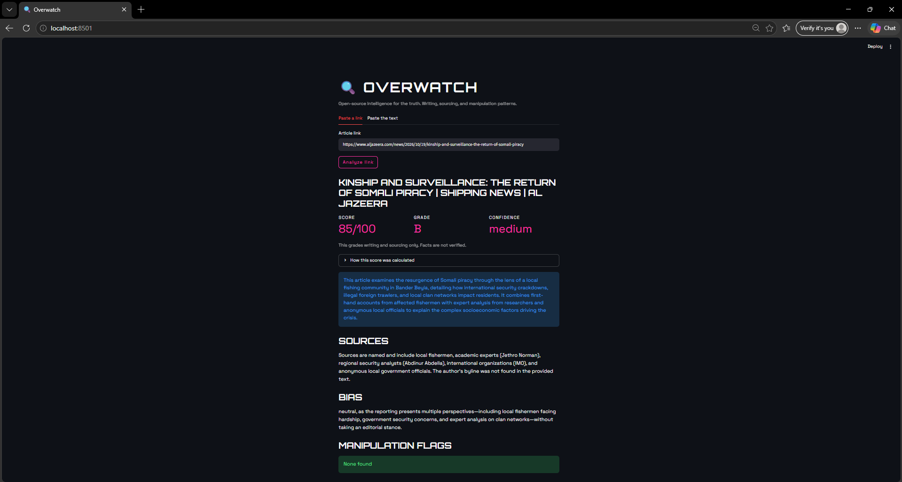

# Overwatch

An open-source tool that checks news articles for writing quality, sourcing, and manipulation patterns.

<<<<<<< HEAD
**Live app:** https://overwatch-01wm.streamlit.app
=======
**Live app:** (https://overwatch-01wm.streamlit.app/)
>>>>>>> 6be82efd75705a6ecbf525e51a991dc002dd8ca8

## What it does
- Scrapes an article from a link, or accepts pasted text
- Uses an AI model to analyze sourcing, bias, and manipulation tactics
- Computes a transparent score with a rule you can read (see scoring.py)
- Gives reverse-image-search links to check photos

## Limits
Overwatch grades writing and sourcing only. It does not verify facts and cannot detect deepfakes. Scores can vary by about 10 points between runs. Treat results as a starting point, never a verdict.

